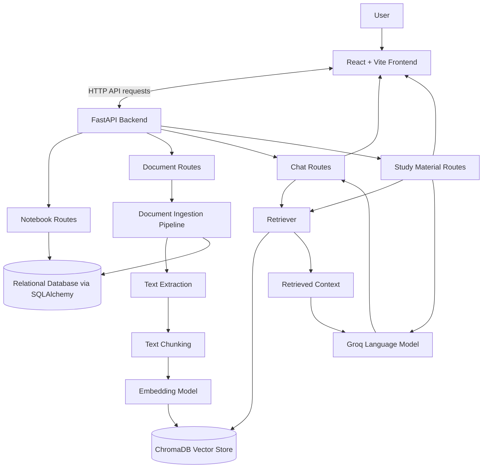

# System Architecture

## Overview

AI Notebook Assistant is a web application for organizing source material and asking questions about it with retrieval-augmented generation (RAG). The system separates the user interface, API layer, document-processing pipeline, retrieval components, language-model calls, and data storage.

The frontend is built with React and Vite. The backend uses FastAPI and exposes API routes for notebooks, documents, chat, and study materials. SQLAlchemy provides access to relational application data, while ChromaDB stores document embeddings and metadata for semantic retrieval. Groq is used to access the language model that generates responses.

## High-Level Architecture



This diagram shows the main logical components and data flow. It is not intended to represent every individual Python module or database table.

## Main Components

### 1. Frontend

The frontend uses React and Vite to provide the notebook interface. It sends requests to the backend API and displays notebook content, uploaded sources, chat responses, and study-material results.

The backend URL is configured through the frontend environment variable `VITE_API_BASE_URL`. In a deployed environment, this variable should point to the deployed API service.

### 2. FastAPI Backend

The backend is the API entry point for the application. The FastAPI application is started from `backend.app.main:app` and registers route groups for the main workflows:

- **Notebook routes:** create and manage notebooks.
- **Document routes:** add sources to a notebook, including supported file uploads and public webpage URLs.
- **Chat routes:** accept questions and return responses based on notebook sources.
- **Study-material routes:** handle supported study-material or artifact-generation requests.

The API also configures Cross-Origin Resource Sharing (CORS) so that the deployed frontend can make requests to the backend. The `FRONTEND_URL` environment setting is used by the deployment configuration.

### 3. Document Ingestion

Ingestion turns an uploaded source into text that can be searched later. The supported input types include PDF, PowerPoint (`.pptx`), text (`.txt`), and public single-page webpage URLs, subject to the current implementation and the limits of each extractor.

The general workflow is:

1. Receive the source and associate it with a notebook.
2. Extract readable text from the file or webpage.
3. Split the text into smaller chunks using the configured text-splitting logic.
4. Generate an embedding for each chunk.
5. Store the chunk embeddings and associated source metadata in ChromaDB.
6. Store the relevant structured application or source records through the relational data layer, where implemented.

Chunking makes long documents easier to search and helps the system pass selected passages to the language model instead of an entire source. Chunk size and overlap affect both retrieval precision and how much surrounding context is retained.

### 4. Embeddings and Vector Storage

The current embedding configuration uses ChromaDB's `ONNXMiniLM_L6_V2` embedding function, associated with the `all-MiniLM-L6-v2` model family. The embedding function converts text chunks and search queries into vector representations so that semantically related content can be found even when the wording differs.

ChromaDB stores the vectors and associated metadata used by the retrieval workflow. The configured persistence location is controlled by `CHROMA_PERSIST_DIRECTORY` where that setting is used by the running environment.

The vector store is separate from the relational database because they support different operations: vector search is used to find relevant passages, while relational storage is used for structured application records.

### 5. Question Answering (RAG)

When a user asks a question about a notebook, the backend follows the RAG workflow:

1. Receive the question and notebook context.
2. Search the vector store for relevant source chunks.
3. Build context from the retrieved passages and their source information.
4. Send the question and retrieved context to the configured Groq language model.
5. Return the generated response and available source references to the frontend.

The goal is to ground responses in the notebook's source material. Retrieval does not guarantee correctness: if relevant information is missing from the source or the wrong chunks are retrieved, the model may still produce an incomplete or unsupported response. Source references should be checked against the original material.

### 6. Study Materials and Artifacts

The backend has a study-material route group for supported requests that use notebook content. These requests may share the retrieval and language-model components with question answering. The exact generation formats, answer-key behavior, and download options should be documented according to the features implemented in the current version; this document does not assume that every possible artifact format is available.

### 7. Relational Storage

SQLAlchemy is used as the relational data-access layer, with SQLite as the default database configuration. The relational database holds structured application data, while ChromaDB holds vectors and retrieval metadata.

The exact durability of stored data in production depends on the deployed database and disk configuration. A local SQLite file or local vector-store directory should not be assumed to survive redeployments on a hosting platform unless persistent storage is configured and verified.

## Core Data Flows

### Adding a Source

```text
User
  -> Frontend
  -> FastAPI document endpoint
  -> Source extraction
  -> Text chunking
  -> Embedding generation
  -> ChromaDB storage
  -> Response to frontend
```

### Asking a Question

```text
User question
  -> Frontend
  -> FastAPI chat endpoint
  -> Retrieve relevant notebook chunks
  -> Assemble context and source metadata
  -> Groq language model
  -> Answer and available source references
  -> Frontend
```

### Generating Study Material

```text
User request
  -> Frontend
  -> FastAPI study-material endpoint
  -> Use notebook content and, where applicable, retrieved context
  -> Generate requested material with the language model
  -> Return result to frontend
```

## Design Decisions

### Separate relational and vector storage

Structured notebook and application data is handled through SQLAlchemy, while ChromaDB is used for similarity search over document chunks. This separation keeps normal application queries distinct from semantic retrieval.

### Retrieve context before generation

The application uses RAG so that the language model can receive relevant excerpts from the user's sources. This is preferable to asking the model to answer solely from general knowledge when the question is specifically about uploaded material.

### Split documents into chunks

Chunking reduces the amount of text that must be searched and passed to the language model. The chunking configuration is a trade-off: small chunks can be more specific but may lose surrounding context, while large chunks retain context but can include irrelevant text.

### Keep the frontend and backend separate

The React frontend handles interaction and presentation, while FastAPI owns API logic and coordinates ingestion, retrieval, storage, and model calls. This makes the frontend and backend independently configurable and deployable.

## Configuration and Deployment

The application is deployed as separate frontend and backend services on Render.

- Frontend: `https://ai-notebook-assistant-h9s8.onrender.com`
- Backend: `https://ai-notebook-assistant-api.onrender.com`
- API documentation: `https://ai-notebook-assistant-api.onrender.com/docs`

Configuration may include the following environment variables. Confirm the exact names and defaults against the current code before deploying:

| Variable | Purpose |
|---|---|
| `VITE_API_BASE_URL` | Backend API URL used by the frontend build. |
| `FRONTEND_URL` | Frontend origin allowed by backend CORS configuration. |
| `GROQ_API_KEY` | Credential for the Groq API. |
| `GROQ_MODEL` | Configured language model identifier. |
| `DATABASE_URL` | Relational database connection string. |
| `EMBEDDING_MODEL` | Embedding model configuration, if read by the application. |
| `CHROMA_PERSIST_DIRECTORY` | Local persistence directory for ChromaDB, if configured. |

Secrets should be stored in local environment files or the hosting provider's secret settings, not committed to the repository. Free hosting instances can have memory and storage constraints, so large ingestion requests and persistence across restarts should be tested in the deployed environment.

## Reliability and Known Constraints

- Retrieval quality depends on the source text, chunking configuration, embedding model, and retrieval settings.
- Generated answers can be inaccurate even when retrieval is enabled; retrieved evidence and citations should be evaluated.
- Web ingestion is intended for public, single-page content rather than crawling an entire website.
- PDF and PowerPoint extraction quality depends on the document's structure. Scanned PDFs may require OCR if OCR support is not implemented.
- Production persistence depends on how the relational database and ChromaDB storage are configured on the host.
- The deployed backend has encountered resource constraints during ingestion, so the hosted workflow should be retested before a live demonstration.

## RAG Evaluation

Architecture describes how retrieval is intended to work; it does not by itself demonstrate retrieval quality. The project evaluation should compare two retrieval approaches using the same source documents and test questions. Record the chunks returned, retrieval latency, answer grounding, and citation quality, then summarize the observed trade-offs.

See [`rag_evaluation.md`](rag_evaluation.md) for the experiment setup and measured results. Do not report performance measurements until they have been collected.
